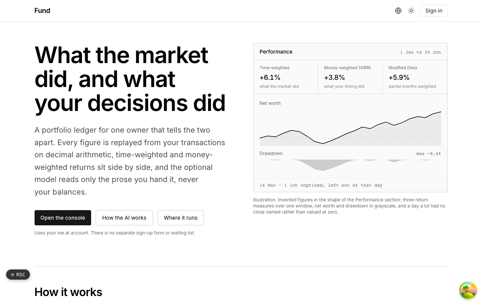

  <picture>
    <source media="(prefers-color-scheme: dark)" srcset=".github/assets/hero-dark.png">
    
  </picture>

# fund.me.at

What the market did, and what your decisions did.

Fund is a portfolio ledger and net-worth tracker for one owner. Accounts, holdings and transactions are recorded over time, and every figure is replayed from those transactions on decimal arithmetic, so the history is the point rather than today's balance. Time-weighted and money-weighted returns sit side by side, research briefs argue in the open, and an optional model reads only the prose you hand it, never your balances. It is self-hostable.

## Features

- **Returns that tell market and timing apart**: time-weighted return, money-weighted return (XIRR) and Modified Dietz for partial periods, computed over the same series.
- **A ledger, not running totals**: balances are derived by replaying transactions against price history, with FIFO cost basis lot by lot and fixed-point decimal arithmetic. Amending an old transaction corrects every month after it.
- **Performance and portfolio views**: net worth, drawdown, allocation and income yield over any window. A holding with no usable price is reported as unpriced rather than valued at zero.
- **Daily price feed with provenance**: closes and FX rates are pulled from a public feed for held and watched symbols, and never overwrite a number the owner typed for the same day.
- **Research briefs written as a debate**: rule-based analysts put weighted evidence on the table, a bull and a bear argue it in turns, and each brief is later scored against what the price actually did. Indicators (moving averages, RSI, MACD, Bollinger bands and more) follow textbook definitions.
- **AI with the rails on**: an optional, off-by-default model may write the fundamentals and news lenses only from prose you supplied, only with a citation, and never with more weight than the arithmetic. Your holdings and amounts are never sent.
- **Journal, commitments and monitors**: a paper trade journal that keeps the decision yours, recurring charges tracked as obligations, and scheduled monitors that can note an event or write a brief and nothing more. Nothing trades on its own.
- **Public journey, without dollar amounts**: an opt-in public page shows only percentage change and milestones the owner chose to publish.

## Built with

- Next.js 16 (App Router), React 19, TypeScript
- Tailwind CSS 4
- Drizzle ORM with Postgres
- oRPC with TanStack Query
- Better Auth
- Optional LLM provider (Anthropic or an OpenAI-compatible endpoint)
- next-intl

## Part of the me.at family

fund.me.at is one of the [`*.me.at`](https://me.at) apps by Trevor McDougald. They share one design system, account, and app shell. Development happens in a private monorepo; this repository is the project's public-facing home.

## License

See [LICENSE](LICENSE).
